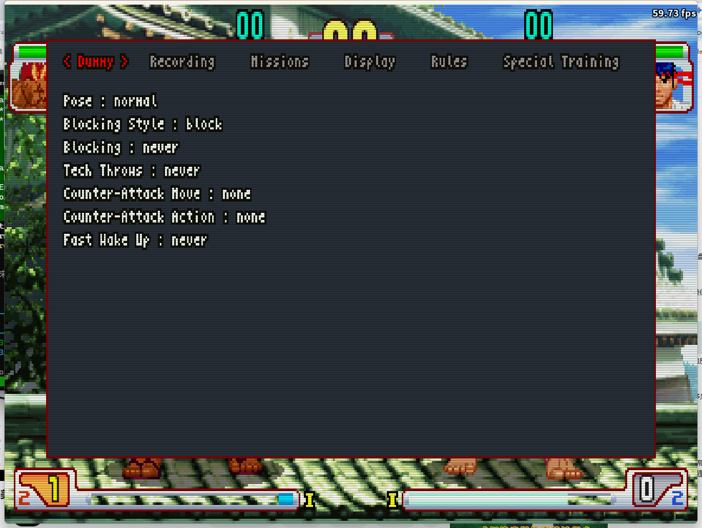

# Dummy

Configure how the CPU-controlled dummy behaves during training. Set its default stance, blocking style, throw tech responses, and counter-attack options.

| Option | Description |
|--------|-------------|
| Pose | Default stance for the dummy: Normal, Crouching, Forward Jump, Neutral Jump, Back Jump, Super Fwd Jump, Super Jump, Super Back Jump, Forward Dash, or Back Dash. |
| Blocking Style | How the dummy defends: block (normal guard), parry (forward parry), or red parry. Enables "Hits before Red Parry" when set to red parry. |
| Hits before Red Parry | Number of hits received before the dummy performs a red parry. Only active when Blocking Style is set to red parry. |
| Blocking Mode | When the dummy triggers its blocking behavior, only active when Blocking Style is set to block: always, combo only, randomly, or frame trap. Set Blocking Style to off if you want the dummy to never block at all. See "Blocking Mode" below for details on combo only and frame trap. |
| Tech Throws | Whether the dummy attempts to escape throws. |
| Counter-Attack Move | Stick motion the dummy performs when counter-attacking: QCF, QCB, HCF, HCB, DPF, DPB, HCharge, VCharge, 360, DQCF, 720, forward, back, down, jump, super jump, forward jump, forward super jump, back jump, back super jump, forward dash, back dash, guard jump, Shun Goku Satsu, Kongou Kokuretsu Zan. |
| Counter-Attack Action | Button the dummy presses for its counter-attack. Set to "recording" to replay a recorded slot instead. |
| Fast Wake Up | Whether the dummy quick-rises after a knockdown. |

---

## Blocking Mode

Only active when Blocking Style is set to block.

| Mode | Behavior |
|------|----------|
| Always | The dummy blocks every hit it predicts. |
| Combo Only | The first hit of each fresh engagement always connects, since the dummy won't block it. Everything after behaves like Always, so a true frame-tight combo naturally connects because the dummy is still in hitstun, while a hit with a gap gets blocked normally. |
| Random | Each predicted hit has a 50% chance of being blocked. |
| Frame Trap | The first "Frame Trap Hits" hits of each fresh engagement always connect, whether or not the dummy could otherwise have reacted and blocked them — useful for testing pressure strings, tick throws, and setups with gaps a real opponent might punish. After that count is reached, "After N Hits" decides what happens next: Block always blocks from then on, Random gives every following hit its own independent 50% chance. |
