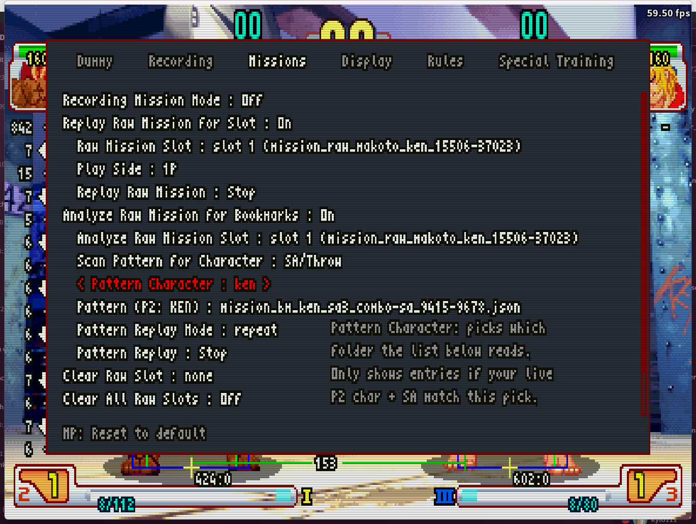

# Missions

Record and replay full matches (Raw Missions) across dedicated slots, and replay individual attack patterns against the dummy.

Pattern files come from two independent sources: patterns you've curated by hand (just `.json`/`.inputs.json` files dropped into `patterns/<character>/`), and the Bookmark Scan tools below, which analyze a recorded Raw Mission and cut out attack patterns automatically.

**Note:** Bookmark Scan's analysis step depends on a separate private tool that isn't included in this repository. The menu options are there, but without that tool, scanning won't find anything to play back. Everything else on this tab (Raw Mission recording/replay, Pattern Replay, and all the Clear options) works standalone.

| Option | Description |
|--------|-------------|
| Recording Mission Mode | Enable Raw Mission record mode. While on, the Dummy, Recording, Rules, and Special Training tabs are grayed out. |
| Record Raw Mission in Slot | Choose which Raw Mission slot to record a full match into. Only active while Recording Mission Mode is on. |
| Replay Raw Mission for Slot | Gate for replaying a recorded Raw Mission. Enables "Raw Mission Slot", "Play Side", and "Replay Raw Mission" below. |
| Raw Mission Slot | Choose which recorded Raw Mission to replay. |
| Play Side | Which side the dummy plays during Raw Mission replay: 1P or 2P. |
| Replay Raw Mission | Start or stop replaying the selected Raw Mission (toggle: start / stop). |
| Analyze Raw Mission for Bookmarks | Gate for the Bookmark Scan tools. Enables "Analyze Raw Mission Slot" and "Scan Pattern for Character" below. |
| Analyze Raw Mission Slot | Choose which recorded Raw Mission to scan for attack patterns. |
| Scan Pattern for Character | Choose the analyzer, then confirm with LP to run it against the selected Raw Mission Slot. Requires the separate private analysis tool mentioned above. |
| Pattern Character | Choose which character's bookmark patterns "Pattern (P2: ?)" below lists. Only shows entries if your live P2 character and SA match a character that has scanned patterns. |
| Pattern (P2: ?) | Select a pattern file to use for Pattern Replay. Shows "empty" until a scan (or hand-curated files in `patterns/<character>/`) produces a match. |
| Pattern Replay Mode | Playback order for patterns: normal (selected pattern only), random, ordered, or repeat (loop current pattern). |
| Pattern Replay | Start or stop pattern replay against the dummy (toggle: start / stop). |
| Clear Raw Slot | Select a Raw Mission slot and confirm with LP to erase it. A confirmation message appears for 5 frames. |
| Clear All Raw Slots | Erase every Raw Mission slot at once. |
| Clear Bookmark Slot | Gate for deleting bookmark pattern files. Enables "Character", "Bookmark Slot", and "Clear Chara All Bookmark Slot" below. |
| Character | Choose which character's bookmark patterns to browse for deletion. |
| Bookmark Slot | Select a bookmark pattern file and confirm with LP to delete it. |
| Clear Chara All Bookmark Slot | Erase every bookmark pattern belonging to the character currently selected above. |
| Clear All Bookmark Slot | Erase every bookmark pattern for every character, regardless of the Clear Bookmark Slot gate or selected Character. |

## Trying the included Ken patterns

`patterns/ken/` ships with 3 ready-made bookmark patterns (a combo into SA3, and two throws) — no scanning or private tooling needed, they're hand-picked `.json` files you can play back right away:

1. Select Ken as P2, with SA3 equipped.
2. Turn **Analyze Raw Mission for Bookmarks** On (this also loads the character list patterns/ were found under — same step needed even for hand-placed files like these).
3. Set **Pattern Character** to `ken`.
4. Pick one of the 3 files under **Pattern (P2: KEN)**.
5. Turn **Pattern Replay** On to play it against your Ken.
